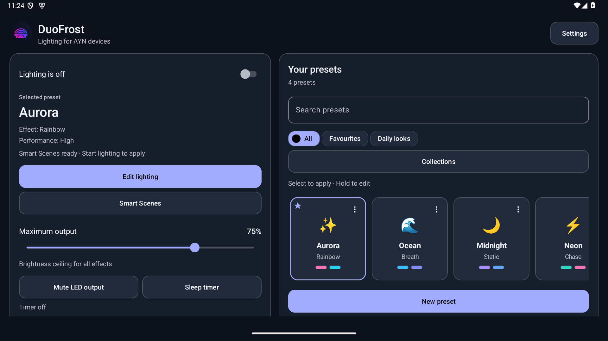

# DuoFrost

**Make your AYN device's lighting your own.**

DuoFrost brings screen-matching colours, audio-reactive lighting and custom LED
effects to AYN devices. Choose a look, organise your presets or let Smart Scenes
adapt your lighting to your apps, games, time and battery.

An independent, open-source continuation of
[BiFrost](https://github.com/Pollux-MoonBench/Bifrost), maintained by
**Stefan van Den Broek (Tufein)**. The maintainer's device is **AYN Thor**.

**[Download DuoFrost 2.5.0](https://github.com/Tufein/DuoFrost/releases/download/v2.5.0/DuoFrost-2.5.0.apk)** ·
[Release notes](https://github.com/Tufein/DuoFrost/releases/tag/v2.5.0) ·
[User guide](docs/2.5.0.md) · [Report a problem](https://github.com/Tufein/DuoFrost/issues)

*App interface captured in an Android emulator; sample presets shown.*

## New in 2.5.0

- **A cleaner interface:** a clear lighting dashboard, readable preset cards and
  direct output, mute and timer controls. Layouts adapt to narrow and wide windows,
  including short landscape screens.
- **Smart Scenes:** combine apps or game groups, hours, weekdays, battery and
  charging conditions. Choose a preset or dim the current look, see why a rule
  applies, and hold a temporary choice for 15–120 minutes.
- **A better preset library:** favourites, named collections and search work
  together. Preview saved colours and supported animations before applying them.
- **Safer sharing:** review imported presets, choose how matching names are
  handled and opt into app assignments. Undo one eligible import or deletion
  for ten minutes while no later relevant changes have been made.
- **Stability improvements:** calmer app/game switching, safer preset handling
  and backups that include scenes, favourites and collections.

BiFrost's ambient colours, audio effects, Ambi Aurora, separate left/right
controls, presets, app profiles, themes and integrations remain the foundation.
DuoFrost also adds background controls, brightness limits, sleep timers, temporary
mute, widgets and more flexible schedules. See the [changelog](CHANGELOG.md) for
the changes from BiFrost and earlier DuoFrost versions.

## Install or update

1. Export a full backup and keep it outside the app.
2. Download the APK above and open it on your AYN device.
3. Follow the first-run guide, choose a preset and grant only the permissions you need.

**DuoFrost 2.1.0, 2.3.0 and the 2.5.0 alphas update in place.** Your presets and
settings are retained. Keep the backup until you have checked the update.

**Original Version 1 or Version 2 needs a one-time reinstall.** Export a full
backup outside the app **before uninstalling**. Uninstall the old DuoFrost,
install 2.5.0, import your backup and grant the needed permissions again.
The original Version 2 APK retains Android version 1.5.1.

Coming from BiFrost? DuoFrost installs alongside it. Export your presets, themes
or backup from BiFrost, then import them into DuoFrost. Run one LED controller at
a time. For Obtainium, add [this repository](https://github.com/Tufein/DuoFrost).

Ambient and audio effects need capture permission. Samples are processed locally;
captured content is not recorded or uploaded. For background lighting, allow
DuoFrost to run in the background in Android's battery settings. After an Android
Force stop, open the app again.

**Hidden feature — tidy Recent apps:** DuoFrost's window stays out of Android's
Recent apps list. Reopen it from its app icon; use Start/Stop to control lighting.

## Open source and credits

Based on BiFrost by **Pollux / Pollux-MoonBench**, with contributions from
**KuriGohan-Kamehameha**, **paradox**, **hupo224** and the upstream community.
Original authorship and Git history are preserved; see [credits](CREDITS.md).

Source and releases are available under [GPLv3](LICENSE). Forks and contributions
are welcome. DuoFrost is not affiliated with AYN.
